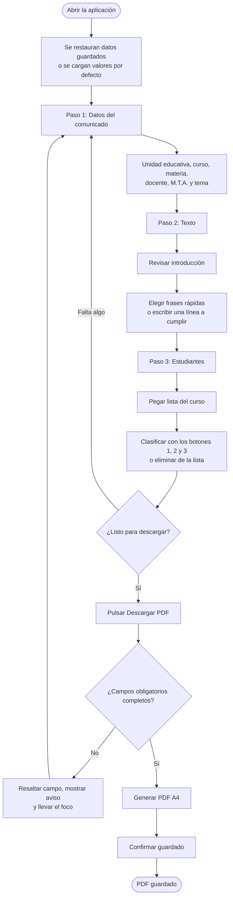
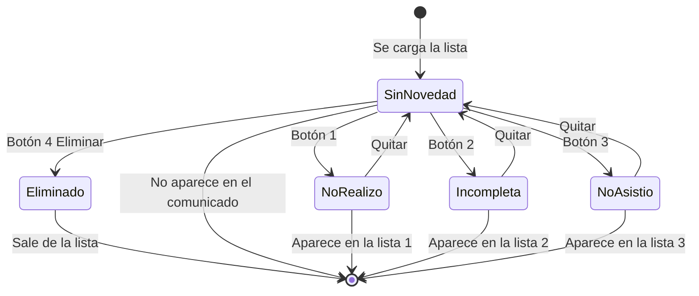
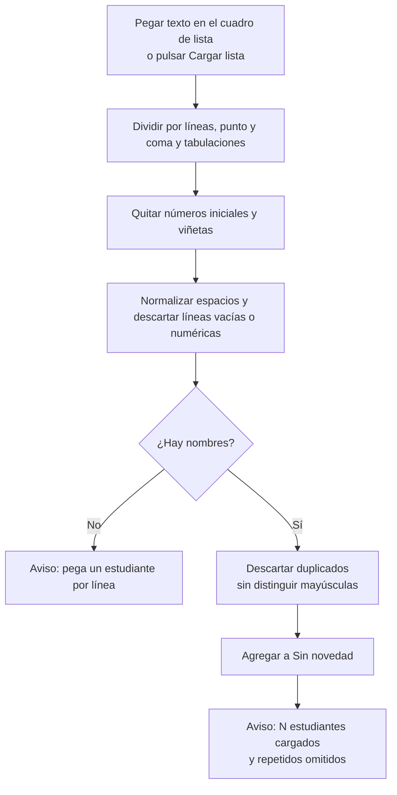
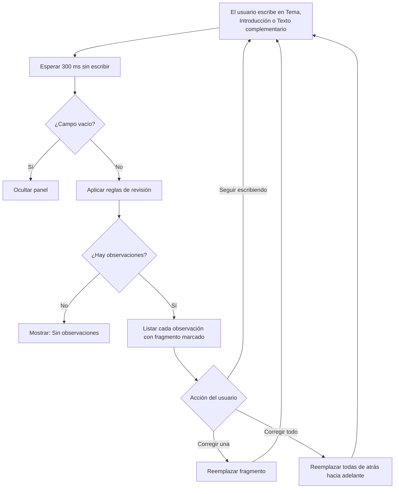
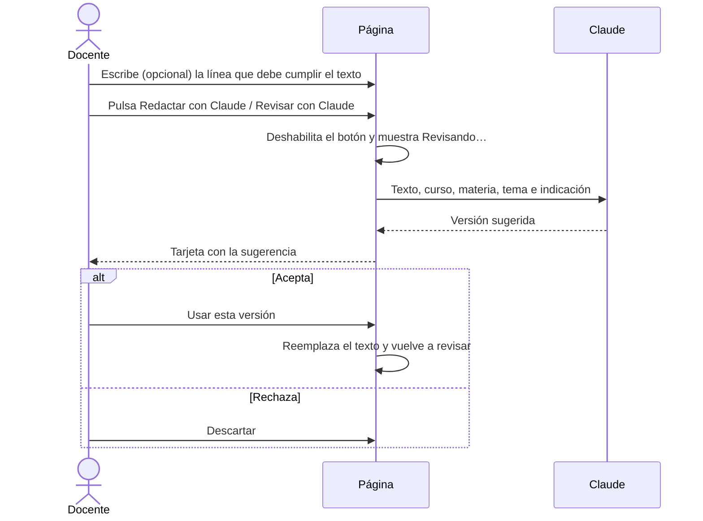
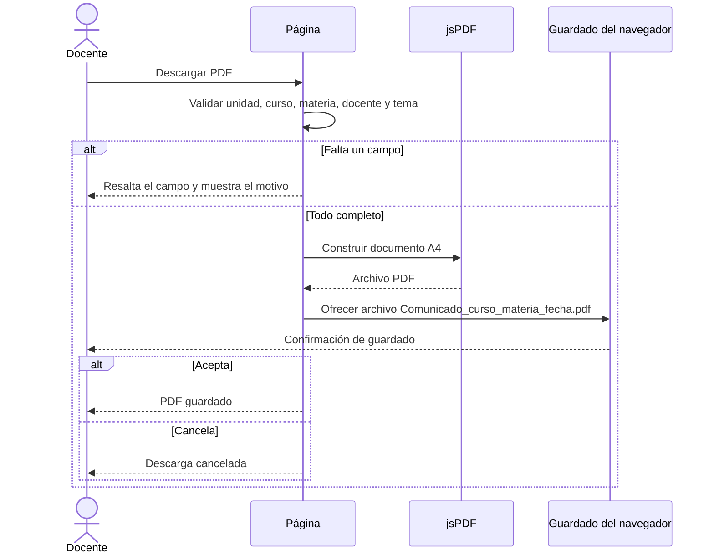
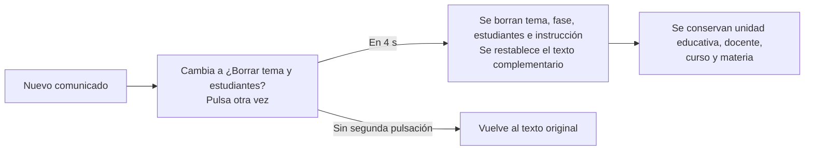
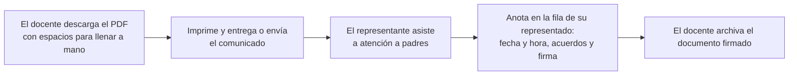

# Flujo de la Aplicación (App Flow)

**Producto:** Comunicados Académicos
**Versión:** 1.1 · 17 de octubre de 2026

Los diagramas usan Mermaid, que GitHub muestra automáticamente.

---

## 1. Flujo principal del usuario

Los pasos 1, 2 y 3 pueden hacerse en cualquier orden; la vista previa se actualiza con cada cambio.

## 2. Estados de un estudiante

Cada cambio de estado actualiza, en este orden: las casillas de la pantalla, la introducción automática (si no fue editada), la vista previa, la revisión de redacción y el guardado local.

## 3. Carga de la lista de estudiantes

## 4. Revisión de redacción

## 5. Texto con ayuda de Claude (opcional)

Disponible solo cuando la página se abre dentro de Claude.

Si la consulta falla o no hay permiso, se muestra un aviso y el resto de la aplicación sigue funcionando.

## 6. Generación y descarga del PDF

## 7. Reinicio

## 8. Persistencia

| Evento | Qué se guarda |
|---|---|
| Cualquier cambio en el formulario o en las casillas | El estado completo, 350 ms después del último cambio |
| Abrir la página | Se restaura el estado; si no existe, se usan los valores por defecto |
| Modo automático activo | Fecha y hora se vuelven a calcular al abrir y cada 15 segundos |

## 9. Mapa de pantallas

La aplicación tiene una única pantalla con tres secciones y una vista previa:

| Sección | Contenido | Acciones |
|---|---|---|
| Encabezado | Título y «Nuevo comunicado» | Reiniciar |
| 1 · Datos | Unidad, fecha y hora, curso, materia, docente, M.T.A., tema | Elegir, escribir, corregir |
| 2 · Texto | Introducción, frases rápidas, atención a padres, texto complementario, línea a cumplir | Editar, insertar, restablecer, consultar a Claude |
| 3 · Estudiantes | Lista, «Sin novedad» y tres casillas | Cargar, clasificar, quitar, eliminar, vaciar |
| Opciones | Mayúsculas y firmas del docente y de la autoridad (cargo y nombre), y espacios para llenar a mano | Activar o desactivar, escribir el nombre, descargar |
| Vista previa | Hoja del comunicado | Solo lectura; descargar PDF |

## 10. Uso del documento impreso en atención a padres

Esta parte ocurre fuera de la aplicación: el registro queda en el papel.
