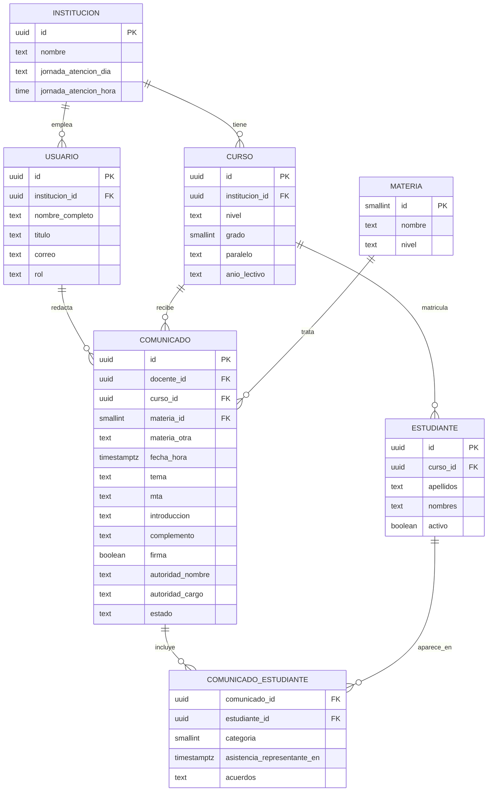

# Esquema del Servidor y de la Base de Datos (Backend Schema)

**Producto:** Comunicados Académicos
**Versión:** 1.1 · 17 de octubre de 2026

> **Estado actual.** La versión 1.0 **no tiene servidor ni base de datos**. Todo funciona en el navegador y los datos se guardan en `localStorage`.
> La sección 1 documenta el esquema real que existe hoy. Las secciones 2 en adelante son un **diseño propuesto** para una versión 2.0 y todavía no están implementadas.

---

## 1. Esquema actual (implementado): almacenamiento local

| Propiedad | Valor |
|---|---|
| Tecnología | `localStorage` del navegador |
| Clave | `comunicados-academicos-v1` |
| Formato | Un objeto JSON |
| Alcance | Un solo navegador y dispositivo; no se comparte ni se sincroniza |
| Escritura | 350 ms después del último cambio |

### Campos

| Campo | Tipo | Valor por defecto | Descripción |
|---|---|---|---|
| `inst` | texto | `"OTTO SHARNOW"` | Nombre de la unidad educativa |
| `auto` | booleano | `true` | Fecha y hora automáticas |
| `fecha` | texto `AAAA-MM-DD` | fecha actual de Ecuador | Fecha del comunicado |
| `hora` | texto `HH:MM` | hora actual de Ecuador | Hora del comunicado |
| `grado` | texto | `""` | Ejemplo: `"8.° de EGB"` |
| `materia` | texto | `""` | Nombre de la materia o `"__otra"` |
| `materiaOtra` | texto | `""` | Nombre cuando `materia` es `"__otra"` |
| `docente` | texto | `"MSc. Carlos Reinoso"` | Docente |
| `mta` | texto | `""` | Fase del método (vacío si no se indica) |
| `tema` | texto | `""` | Tema del comunicado |
| `intro` | texto | calculado | Párrafo de introducción |
| `introEdited` | booleano | `false` | Si el usuario modificó la introducción |
| `comp` | texto | frase de atención a padres | Texto complementario |
| `dia` | texto | `"miércoles"` | Día de atención a padres |
| `horaAt` | texto `HH:MM` | `"13:30"` | Hora de atención a padres |
| `instr` | texto | `""` | Línea que debe cumplir el texto |
| `alumnos` | lista | `[]` | Ver abajo |
| `mayus` | booleano | `true` | Nombres en mayúsculas |
| `firma` | booleano | `false` | Incluir las firmas del docente y de la autoridad |
| `dirNombre` | texto | `""` | Nombre de la autoridad que firma |
| `dirCargo` | texto | `"Director/a"` | `Rector/a`, `Vicerrector/a`, `Director/a`, `Subdirector/a`, `Inspector/a General`, `Subinspector/a`, `Coordinador/a` |
| `tabla` | booleano | `true` | Imprimir la tabla con espacios para llenar a mano (asistencia del representante legal, acuerdos y firma del representante legal) |
| `nextId` | entero | `1` | Siguiente identificador de estudiante |

### Elemento de `alumnos`

| Campo | Tipo | Descripción |
|---|---|---|
| `id` | entero | Identificador dentro de la lista |
| `name` | texto | Apellidos y nombres tal como se pegaron |
| `cat` | entero 0 a 3 | `0` sin novedad, `1` no realizó, `2` entregó incompleta, `3` no asistió |

### Reglas al leer

- Los campos desconocidos se ignoran; los faltantes toman el valor por defecto.
- Se descartan estudiantes con `id` o `name` inválidos y los `cat` fuera de rango pasan a `0`.
- Si el almacenamiento no está disponible, la aplicación funciona sin recordar datos.

---

## 2. Propuesta 2.0: arquitectura

Solo es necesaria si se quiere sincronizar entre dispositivos, guardar historial, o enviar comunicados por correo.

```
Navegador (misma aplicación)
      │  HTTPS · JSON
      ▼
API REST  ──►  Base de datos PostgreSQL
      │
      └──►  Servicio de correo (envío del PDF)
```

| Componente | Opción sugerida |
|---|---|
| API | Node.js con Express o Fastify, o un servicio gestionado (Supabase, Firebase) |
| Base de datos | PostgreSQL |
| Autenticación | Correo y contraseña, o inicio de sesión con la cuenta institucional |
| Archivos | Almacenamiento de objetos para los PDF generados (opcional) |

## 3. Propuesta 2.0: modelo de datos



## 4. Propuesta 2.0: definición de tablas (PostgreSQL)

```sql
CREATE TABLE institucion (
  id                    uuid PRIMARY KEY DEFAULT gen_random_uuid(),
  nombre                text NOT NULL,
  jornada_atencion_dia  text CHECK (jornada_atencion_dia IN
                          ('lunes','martes','miércoles','jueves','viernes')),
  jornada_atencion_hora time
);

CREATE TABLE usuario (
  id              uuid PRIMARY KEY DEFAULT gen_random_uuid(),
  institucion_id  uuid NOT NULL REFERENCES institucion(id),
  nombre_completo text NOT NULL,
  titulo          text,                      -- ejemplo: MSc.
  correo          text NOT NULL UNIQUE,
  rol             text NOT NULL DEFAULT 'docente'
                    CHECK (rol IN ('docente','autoridad','administrador')),
  creado_en       timestamptz NOT NULL DEFAULT now()
);

CREATE TABLE curso (
  id             uuid PRIMARY KEY DEFAULT gen_random_uuid(),
  institucion_id uuid NOT NULL REFERENCES institucion(id),
  nivel          text NOT NULL CHECK (nivel IN ('EGB','BGU')),
  grado          smallint NOT NULL CHECK (grado BETWEEN 1 AND 10),
  paralelo       text,
  anio_lectivo   text NOT NULL,              -- ejemplo: 2026-2027
  CHECK ((nivel = 'EGB') OR (nivel = 'BGU' AND grado BETWEEN 1 AND 3))
);

CREATE TABLE estudiante (
  id        uuid PRIMARY KEY DEFAULT gen_random_uuid(),
  curso_id  uuid NOT NULL REFERENCES curso(id),
  apellidos text NOT NULL,
  nombres   text NOT NULL,
  activo    boolean NOT NULL DEFAULT true
);

CREATE TABLE materia (
  id     smallint PRIMARY KEY,
  nombre text NOT NULL UNIQUE,
  nivel  text NOT NULL CHECK (nivel IN ('EGB','BGU','AMBOS'))
);

CREATE TABLE comunicado (
  id           uuid PRIMARY KEY DEFAULT gen_random_uuid(),
  docente_id   uuid NOT NULL REFERENCES usuario(id),
  curso_id     uuid NOT NULL REFERENCES curso(id),
  materia_id   smallint REFERENCES materia(id),
  materia_otra text,
  fecha_hora   timestamptz NOT NULL,
  tema         text NOT NULL,
  mta          text CHECK (mta IN
                 ('Fase 1: Autoaprendizaje','Fase 2: Coaprendizaje','Fase 3: Socialización')),
  introduccion text NOT NULL,
  complemento  text,
  firma        boolean NOT NULL DEFAULT false,
  autoridad_nombre text,
  autoridad_cargo  text CHECK (autoridad_cargo IN ('Rector/a','Vicerrector/a','Director/a','Subdirector/a',
                     'Inspector/a General','Subinspector/a','Coordinador/a')),
  estado       text NOT NULL DEFAULT 'borrador'
                 CHECK (estado IN ('borrador','generado','enviado')),
  creado_en    timestamptz NOT NULL DEFAULT now(),
  CHECK (materia_id IS NOT NULL OR materia_otra IS NOT NULL)
);

CREATE TABLE comunicado_estudiante (
  comunicado_id uuid NOT NULL REFERENCES comunicado(id) ON DELETE CASCADE,
  estudiante_id uuid NOT NULL REFERENCES estudiante(id),
  categoria     smallint NOT NULL CHECK (categoria IN (1,2,3)),
  asistencia_representante_en timestamptz,   -- opcional 2.0: se llena tras la atención a padres
  acuerdos            text,          -- opcional 2.0: acuerdos o compromisos
  PRIMARY KEY (comunicado_id, estudiante_id)
);
-- categoria: 1 no realizó · 2 entregó incompleta · 3 no asistió
-- Un estudiante "sin novedad" no tiene fila.

CREATE INDEX idx_comunicado_docente_fecha ON comunicado (docente_id, fecha_hora DESC);
CREATE INDEX idx_estudiante_curso ON estudiante (curso_id) WHERE activo;
```

## 5. Propuesta 2.0: puntos de acceso de la API

| Método | Ruta | Descripción |
|---|---|---|
| `POST` | `/auth/login` | Inicia sesión |
| `GET` | `/cursos` | Cursos del docente |
| `GET` | `/cursos/:id/estudiantes` | Lista de estudiantes del curso |
| `POST` | `/cursos/:id/estudiantes` | Carga masiva de estudiantes |
| `GET` | `/materias` | Catálogo de materias |
| `GET` | `/comunicados` | Historial (filtros por curso, materia y fecha) |
| `POST` | `/comunicados` | Crea un comunicado con sus estudiantes por categoría |
| `GET` | `/comunicados/:id` | Detalle |
| `PUT` | `/comunicados/:id` | Edita un borrador |
| `POST` | `/comunicados/:id/enviar` | Envía el PDF por correo a los representantes |

Ejemplo de cuerpo para `POST /comunicados`:

```json
{
  "cursoId": "…",
  "materiaId": 4,
  "fechaHora": "2026-10-15T11:35:00-05:00",
  "tema": "Lección: Los niveles de organización de la materia viva.",
  "mta": "Fase 3: Socialización",
  "introduccion": "…",
  "complemento": "…",
  "firma": false,
  "estudiantes": [
    { "estudianteId": "…", "categoria": 1 },
    { "estudianteId": "…", "categoria": 2 }
  ]
}
```

## 6. Propuesta 2.0: seguridad y datos personales

Los datos de estudiantes menores de edad son información personal sensible. Antes de implementar un servidor:

1. Revisar las obligaciones de la **Ley Orgánica de Protección de Datos Personales** del Ecuador y las políticas de la institución, e informar a los representantes legales sobre el tratamiento.
2. Usar HTTPS en todo momento y almacenar contraseñas con un algoritmo de hash seguro.
3. Aplicar permisos por rol: un docente solo ve sus cursos y comunicados.
4. Aplicar seguridad a nivel de fila en la base de datos (por ejemplo, políticas por `institucion_id`).
5. Guardar solo los datos necesarios (apellidos, nombres y curso); no almacenar cédulas ni datos de contacto sin una necesidad definida.
6. Definir cuánto tiempo se conservan los comunicados y permitir su eliminación.
7. Registrar accesos y cambios (auditoría).
8. No publicar datos reales en el repositorio de GitHub.

## 7. Migración de la versión 1.0 a la 2.0

| Dato local (`localStorage`) | Destino en la base de datos |
|---|---|
| `inst` | `institucion.nombre` |
| `docente` | `usuario.nombre_completo` y `usuario.titulo` |
| `grado` | `curso.nivel` y `curso.grado` |
| `materia` / `materiaOtra` | `comunicado.materia_id` / `comunicado.materia_otra` |
| `alumnos[].name` | `estudiante.apellidos` y `estudiante.nombres` (requiere separar el nombre) |
| `alumnos[].cat` | `comunicado_estudiante.categoria` (los `0` no se guardan) |
| `tema`, `mta`, `intro`, `comp`, `firma` | Columnas del mismo nombre en `comunicado` |
| `dirNombre`, `dirCargo` | `comunicado.autoridad_nombre`, `comunicado.autoridad_cargo` |
| `tabla` | Solo es una opción de impresión; no se guarda en la base de datos |
